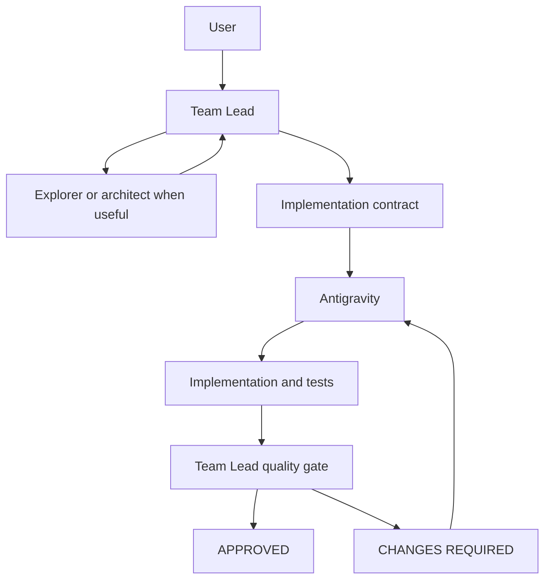

# AI Engineering Orchestrator

An MCP bridge plus policy presets that make Codex or Claude Code act as a Team Lead and delegate substantive implementation to a cheaper model.

For developers already paying for an expensive reasoning model who also have a cheaper implementation model available.

The economic thesis: expensive model decides, cheap model types.

## See it work

<!-- TODO: record with scripts/record-demo instructions in docs/demo.md -->
<!--  -->

Test B is a prompt that never names Antigravity, and delegation happening anyway is the pass condition; see [examples/smoke-test.md](examples/smoke-test.md).

Real excerpt from a Test B run on Claude Code against a Laravel project (October 2026). Trimmed for length; the Team Lead's wording is unchanged, and project-internal file names are generalized.

```text
> Inspect the refresh-token lifecycle problem, implement the necessary
> production-ready correction, add appropriate regression coverage, and verify
> the result without unnecessarily changing the architecture.

I'll start by locating the refresh-token code and capturing the git baseline,
then decide the fix and delegate the implementation.

Diagnosis done. Four lifecycle defects found in the admin refresh flow. Now
writing the implementation contract and delegating to Antigravity.

Baseline: M .claude/launch.json only. Delegating the fix now.

  Used aeo-antigravity: delegate antigravity

Antigravity reports done. Reviewing the actual diff and re-running tests myself.

All 16 auth tests pass, but I noticed the logout action uses a service-locator
fallback instead of plain injection. I'll fix that small issue and then run
the full test suite.

Verdict: APPROVED. The admin refresh-token lifecycle had four real defects. All
are fixed in api/, covered by regression tests, and the full Laravel suite is
green. Nothing is committed yet.

Verification I ran myself
  Auth and session test filter   65 passed
  Full php artisan test          854 passed, 7 skipped (pre-existing)
  Pint on changed files          passed

Antigravity ran the new prune command against your local dev database while
verifying, which deleted 17 old refresh-token rows there. Production was not
touched.
```

The prompt never named Antigravity or any tool. The Team Lead recorded the baseline, delegated the substantive fix, re-ran the tests itself, kept one trivial edit (a constructor-injection cleanup) for itself — exactly the split the policy prescribes — and reported a side effect of the engineer's verification instead of hiding it. The last paragraph is also a reminder that the Antigravity permission profile decides which commands a headless engineer may run; see [docs/permissions.md](docs/permissions.md). The full implementation contract behind this run is in [docs/implementation-contract.md](docs/implementation-contract.md#a-real-contract).

## Measured example

| Task | Team Lead tokens | Engineer tokens | Total cost with delegation | Estimated cost without delegation |
| --- | --- | --- | --- | --- |
| TODO | TODO | TODO | TODO | TODO |

Numbers come from `scripts/measure-delegation.mjs` in a source checkout (it is not part of the npm package) and are account-specific. The script prints rows in this format. AEO ships no cost meter and this repository does not guarantee a savings number. See [How to measure your own savings](docs/cost-aware-routing.md#how-to-measure-your-own-savings).

## Overview

The Team Lead understands the task, looks at the repository, writes a bounded contract, and decides whether the result is acceptable. The Implementation Engineer does the substantive editing and does not approve its own work.

MCP lets the Team Lead call the implementation model. The policy file decides when and why that delegation should happen.

| Piece | What it contributes |
| --- | --- |
| MCP bridge | Capability: `delegate_antigravity` and `delegate_cursor`, each with `apply_delegation` and `discard_delegation` for worktree-isolated parallel work |
| `AGENTS.md` or `CLAUDE.md` | Policy |
| Model | Reasoning |
| Repository and tests | Evidence |
| Team Lead | Final authority |

- This repository does not measure or guarantee a savings number.
- "Cheaper" is relative to your own account, region, and discounts, not a vendor ranking. See [docs/cost-aware-routing.md](docs/cost-aware-routing.md).
- This is a local reference implementation, not a hosted product.

## Architecture



Two presets are included:

- Codex as Team Lead, Gemini through Antigravity as Implementation Engineer
- Claude Code as Team Lead, Gemini through Antigravity as Implementation Engineer

Supporting roles are not a ladder. AEO installs them under namespaced ids (`aeo_explorer`, `aeo_architect`, `aeo_reviewer`, `aeo_fast_worker` on Codex; `aeo-explorer`, `aeo-architect`, `aeo-reviewer`, `aeo-fast-worker` on Claude). Antigravity implements by default. On model quota exhaustion the Antigravity bridge first retries the models in `AEO_AGY_FALLBACK_MODELS`; only when it returns `quota_or_auth_failure` or `cli_failure` does the policy fall back to Cursor via `delegate_cursor` on `aeo-cursor`. See [bridge/cursor-mcp](bridge/cursor-mcp/README.md).

Details and a second diagram are in [docs/architecture.md](docs/architecture.md). The four workflow figures are in [diagrams/architecture.md](diagrams/architecture.md). Rules for keeping Team Lead context small are in [docs/context-hygiene.md](docs/context-hygiene.md).

Safe by default: project-scoped, namespaced, reversible. Full semantics in [docs/install.md](docs/install.md).

## Quick start

- Node.js 20 or newer. The installer exits before writing when Node is older.
- The Antigravity CLI (`agy`) on `PATH`, or `AGY_BIN` pointing at it
- An interactive `agy` login before headless runs
- Codex or Claude Code for the Team Lead preset you want to use

Install from npm. A normal install does not need a clone of this repository. Dry-run first; it writes nothing.

```bash
# Project install: pass --codex, --claude, or both
npx ai-engineering-orchestrator@latest install --target . --codex --claude --dry-run
npx ai-engineering-orchestrator@latest install --target . --codex --claude
npx ai-engineering-orchestrator@latest doctor --target .

# Optional global install of the CLI. This does not turn on --global.
npm install -g ai-engineering-orchestrator
aeo install --target . --codex
aeo doctor --target .

# User-scope Codex and Claude configuration is a separate, explicit step
aeo install --global --codex --claude --dry-run
aeo install --global --codex --claude
aeo doctor --global
```

1. Confirm Node.js 20 or newer.
2. Confirm the Antigravity CLI works: `agy -p "Reply with the single word ready." --mode accept-edits --output-format json --print-timeout 2m`
3. Dry-run, then install into the target project.
4. Read the change summary. Backups of shared files that AEO actually changes are under `~/.aeo/backups/<project-id>/<timestamp>/` (or `~/.aeo/backups/global/<timestamp>/`).
5. Start a new Codex or Claude session.
6. Run doctor.
7. Run [Test B](examples/smoke-test.md). Test B does not name Antigravity. A substantive fix should still be delegated.

Pass `--codex`, `--claude`, or both. If you pass neither, the installer stops instead of guessing. `npm install -g` installs the `aeo` command; it does not turn on `--global`. AEO modifies Codex and Claude configuration only inside the target project, and only AEO-owned names. Global Codex and Claude config are not modified unless `--global`.

From a source checkout, `install.ps1`, `install.sh`, and `node scripts/aeo.mjs` run the same command as the published `aeo` binary. `npm test` from the repository root, and `npm test` in each bridge, do not need `agy` or Cursor credentials. See [Development / Install from source](docs/install.md#development--install-from-source).

The manual merge, if you do not want the installer, is in [docs/install.md](docs/install.md).

## Supported presets

| Team Lead | Policy fragment | Installer merge |
| --- | --- | --- |
| OpenAI Codex | [presets/codex/orchestration-block.md](presets/codex/orchestration-block.md) | Managed block in the project `AGENTS.md`, namespaced agents, and a project `.codex/config.toml` block |
| Claude Code | [presets/claude/rules/aeo-orchestration.md](presets/claude/rules/aeo-orchestration.md) | `.claude/rules/aeo-orchestration.md`, namespaced agents, one `.mcp.json` server, and three allow entries |

Both say the same thing about substantive work: Antigravity is the mandatory default Implementation Engineer.

Model names in the Codex agent files are examples. Replace them with models your account provides. You may customize agent model settings. AEO tracks installed file hashes, so normal updates preserve modified agent files instead of silently replacing them.

## Security model

Example files contain no keys. Do not add any. Permission examples deny push, reset, clean, rebase, merge, and commit. The Team Lead still has to read the diff. Private vulnerability reports go through GitHub Security Advisories. See [SECURITY.md](SECURITY.md). The bridge does not disable Antigravity permission checks; read [docs/permissions.md](docs/permissions.md) before widening any allow list.

## Details

- [docs/install.md](docs/install.md) — installation, ownership, manifest, update and uninstall semantics, bridge setup, environment variables, Codex trust
- [docs/permissions.md](docs/permissions.md)
- [docs/customization.md](docs/customization.md)
- [docs/architecture.md](docs/architecture.md)
- [docs/cost-aware-routing.md](docs/cost-aware-routing.md)
- [docs/context-hygiene.md](docs/context-hygiene.md)
- [docs/policy-vs-capability.md](docs/policy-vs-capability.md)
- [docs/implementation-contract.md](docs/implementation-contract.md)
- [docs/quality-gate.md](docs/quality-gate.md)
- [docs/revision-loop.md](docs/revision-loop.md)
- [docs/troubleshooting.md](docs/troubleshooting.md)
- [docs/demo.md](docs/demo.md)
- [examples/smoke-test.md](examples/smoke-test.md), [examples/feature-task.md](examples/feature-task.md), [examples/bug-fix-task.md](examples/bug-fix-task.md), [examples/high-risk-task.md](examples/high-risk-task.md)
- [bridge/antigravity-mcp/README.md](bridge/antigravity-mcp/README.md)
- [bridge/cursor-mcp/README.md](bridge/cursor-mcp/README.md)
- [CONTRIBUTING.md](CONTRIBUTING.md)
- [SECURITY.md](SECURITY.md)

## License

[MIT](LICENSE).
